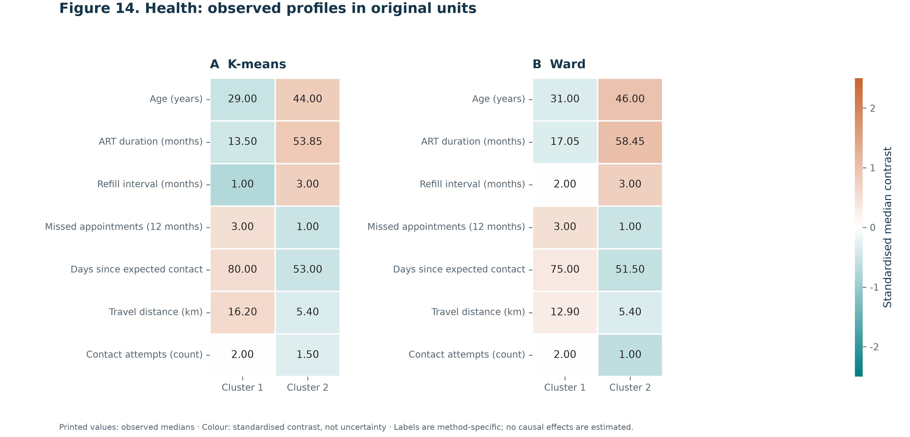
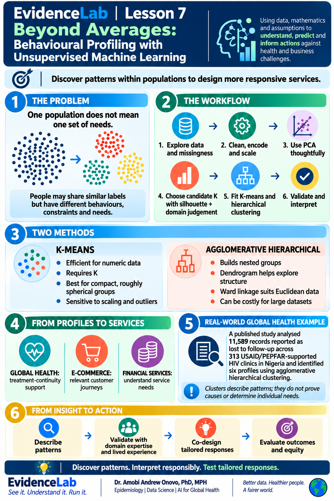
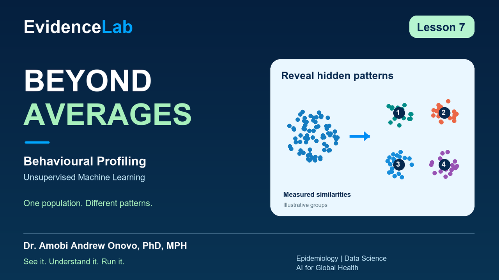

# Lesson 07 — Beyond Averages

## Behavioural Profiling with Unsupervised Machine Learning

One population does not necessarily mean one set of needs. Explore synthetic global-health and e-commerce data, compare K-means and Ward hierarchical clustering, and interpret population profiles responsibly.

[Read or download the notebook](EvidenceLab_07_Behavioural_Profiling_Journal.ipynb) · [Download journal-style outputs](EvidenceLab_07_Journal_Outputs.zip) · [Verification record](QA.json)

Select **Runtime → Run all**, then read from top to bottom. Both datasets are generated automatically; no upload or API key is needed.

### Figures and tables

The notebook produces 16 numbered figure sets and 27 numbered tables. Figures export as SVG, PDF and 300-dpi PNG. Tables export full-precision CSVs, styled HTML, and print-ready PNG/SVG/PDF pages. Captions state data provenance, units, denominators and interpretive limits. Dense scatter points are rasterised within vector containers to keep files manageable; vector labels remain editable.

White backgrounds, restrained teal/orange accents, marker shapes, consistent typography and aligned comparison axes support print and notebook use. Check the chosen journal's exact page dimensions and submission requirements when adapting these general journal-style exports.

*Printed cells show observed medians in original units. Colour shows standardised median contrasts, not uncertainty or intervention effects. Cluster labels are method-specific.*

### Scientific interpretation

The primary models use full transformed feature matrices; two-dimensional PCA is a projection. PCA-reduced modelling is compared separately. The highest-silhouette starting candidate is K = 2 for each synthetic dataset, despite four hidden generating patterns. A stable partition need not recover the generating patterns or establish service needs.

Categorical profiles include a Missing level and use all records within each cluster as their denominator. Numeric means and medians use observed values, with nonmissing sample sizes reported. The supplied notebook's data generators, feature preparation, primary model settings and original diagnostic results are preserved; both algorithms now receive symmetric profile tables and figures.

The published Nigerian HIV example reports 11,589 records, 313 supported clinics and six profiles. It is contextual evidence, separate from these synthetic data. [Read the original study](https://www.longdom.org/open-access/aggregating-loss-to-followup-behavior-in-people-living-with-hiv-on-art-a-cluster-analysis-using-unsupervised-machine-learning-algo-1102545.html).

### Infographic

### Explainer preview

YouTube publication pending. Narrated review videos have been prepared locally; no public video URL is available yet.

Created by **Dr. Amobi Andrew Onovo, PhD, MPH**  
Epidemiology | Data Science | AI for Global Health  
**EvidenceLab | See it. Understand it. Run it.**
