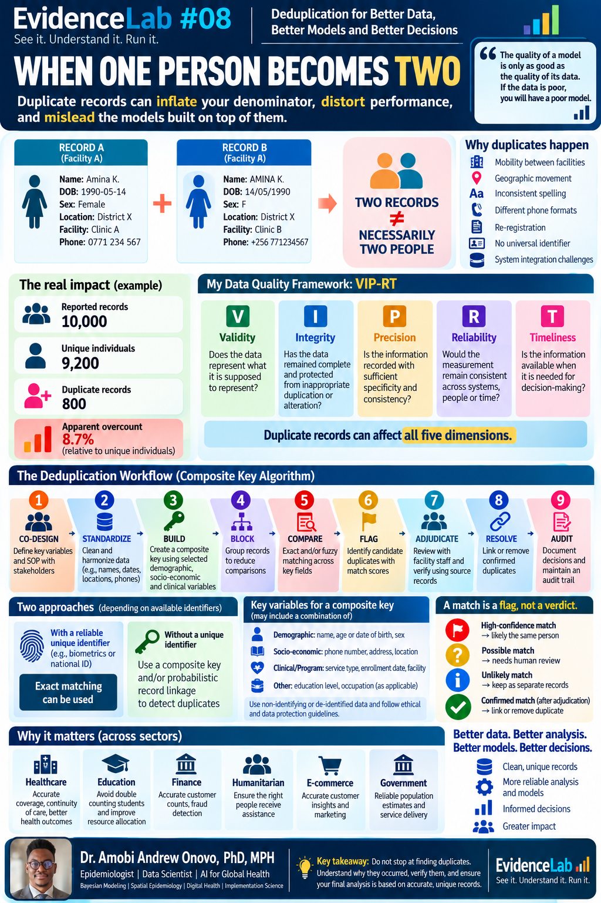
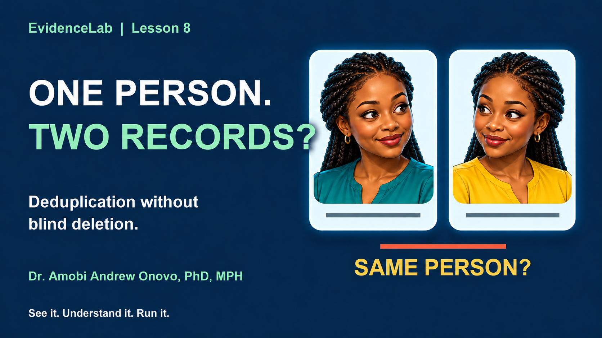

# Lesson 08 — When One Person Becomes Two

## Deduplication with composite keys and record linkage

Learn how duplicate records arise, how to generate candidates for review, and how double counting can affect analysis and models. All data in the notebook are synthetic.

**No coding required. You do not need to write, edit, or understand Python to complete this lesson.** Open the notebook, select **Runtime → Run all**, then read from top to bottom. The prepared code creates the data, performs the analysis, and generates the charts and tables automatically.

[Read or download the notebook](EvidenceLab_08_Deduplication_Composite_Key_FIXED.ipynb) · [Opening-section verification](QA.json)

### Your learning journey

Understand the duplicate-record problem → create synthetic data → check data quality → standardize records → build the composite key → generate candidate matches → score and review candidates → adjudicate and resolve → measure double counting → inspect a downstream model.

The opening guide explains what to do when you encounter a code cell: **Run all** handles it automatically. Exploring the Python is optional.

### Infographic

[Download the infographic](assets/deduplication_infographic.png)

### Explainer

[Download the full explainer — 4 minutes 49 seconds, 1080p](video/EvidenceLab_08_full_Helena_V3.mp4) · [Full subtitles](video/EvidenceLab_08_full_Helena_V3.srt) · [Transcript](video/EvidenceLab_08_Transcript.txt)

[Download the vertical teaser — 31 seconds](video/EvidenceLab_08_short_Helena_V3.mp4) · [Teaser subtitles](video/EvidenceLab_08_short_Helena_V3.srt) · [Thumbnail master](assets/deduplication_thumbnail_master.png)

**YouTube link pending.** The approved video is available above; its YouTube link will be added when supplied.

### Interpret the workflow carefully

**A match is a flag, not a verdict.** Matching keys and similarity scores generate candidates; real-world resolution requires approved human/source-record adjudication, privacy safeguards, secure processing and an audit trail.

The notebook's review decisions are simulated using hidden synthetic truth. Its resolved dataset is explicitly an **oracle benchmark**, not a claim that the candidate workflow finds every duplicate. Candidate-pair recall and end-to-end recall have different denominators. The downstream model comparison uses training AUC for illustration, not predictive validation.

The infographic and video illustrate 10,000 reported records and 9,200 unique people. The notebook separately generates 5,600 records from 5,000 people. These are distinct synthetic examples.

### Revision scope

This release adds beginner guidance and the Lesson 08 journey before the learning objectives. The analysis code, synthetic-data generator, calculations, saved results, visualizations and scientific interpretation are unchanged. The opening thumbnail uses the published image URL for GitHub and Colab.

Created by **Dr. Amobi Andrew Onovo, PhD, MPH**  
Epidemiology | Data Science | AI for Global Health  
**EvidenceLab | See it. Understand it. Run it.**
