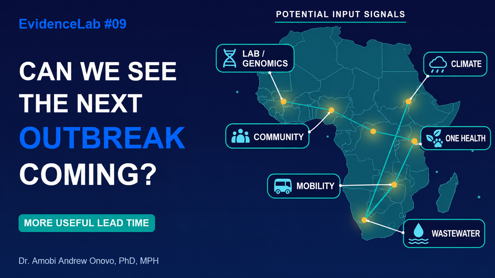
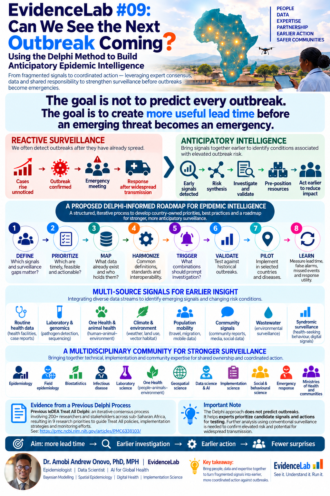

# EvidenceLab #09: Can We See the Next Outbreak Coming?

## Using the Delphi Method to Build Anticipatory Epidemic Intelligence

**The goal is not to predict every outbreak. The goal is to create more useful lead time before an emerging threat becomes an emergency.**

[Watch the full explainer on YouTube](https://youtu.be/AA1HSFzl-kM) · [Download the final infographic](assets/anticipatory_epidemic_intelligence_infographic.png) · [Download the thumbnail](assets/anticipatory_epidemic_intelligence_thumbnail.png)

### From fragmented signals to coordinated action

An unusual laboratory finding, changing environmental conditions or a community report may warrant attention. Bringing relevant information together can help teams decide which combinations deserve investigation, how uncertain an assessment is and what action should follow.

This lesson proposes a country-owned, Delphi-informed roadmap for developing those capabilities. Delphi provides a structured, iterative process: participants contribute independently, responses are synthesized, collective findings are returned for feedback, and priorities are reconsidered across rounds.

**Consensus helps prioritize candidate signals and actions for testing. Empirical evidence must establish whether they are useful.**

### Final infographic

### A proposed Delphi-informed roadmap

**DEFINE → PRIORITIZE → MAP → HARMONIZE → TRIGGER → VALIDATE → PILOT → LEARN**

| Step | Operational question |
| --- | --- |
| Define | Which signals and surveillance gaps matter? |
| Prioritize | Which candidate signals are timely, feasible and actionable? |
| Map | What data already exist, and who holds them? |
| Harmonize | Which definitions, standards and interoperability requirements are needed? |
| Trigger | Which combinations should prompt investigation? |
| Validate | How do candidate signals perform against historical outbreaks? |
| Pilot | How do they perform prospectively in selected settings and diseases? |
| Learn | What changes in lead time, false alarms, missed events and response utility? |

Delphi can inform the priorities and design decisions. Validation, piloting and learning require subsequent analysis and evaluation using conventional surveillance and other relevant evidence.

### Potential input signals

Routine health data, laboratory and genomic findings, One Health and animal-health information, climate and environmental observations, population mobility, community signals, wastewater and syndromic surveillance may contribute. Their availability, relevance, quality, overlap and timeliness vary by setting and disease.

Interpretation requires collaboration across surveillance, laboratory science, One Health, geospatial and data science, implementation science, emergency response, decision-makers and communities.

### From evidence to decisions

**WHERE? → WHEN? → HOW CERTAIN? → WHY?**

These questions support decisions to **INVESTIGATE, MONITOR, PRE-POSITION or RESPOND**, according to verified evidence and local protocols. An alert prompts assessment; it does not establish that an outbreak has been predicted.

**PEOPLE + PROCESS + DATA + TECHNOLOGY + GOVERNANCE → ACTION**

The proposed approach is country-owned, locally prioritized, interoperable where useful, regionally connected and globally supported. Its intended benefit is more useful lead time, earlier investigation, earlier action and fewer surprises. Those benefits need to be evaluated.

### Evidence and further reading

- [IeDEA Treat All research-prioritization study](https://pmc.ncbi.nlm.nih.gov/articles/PMC6338103/): an iterative Delphi process involving more than 200 participants across one or more rounds, producing nine research priorities. The study concerned Treat All implementation in sub-Saharan Africa.
- [WHO: Defining collaborative surveillance](https://www.who.int/publications/i/item/9789240074064): a framework for multisectoral and multi-source collaboration to strengthen public-health intelligence.
- [WHO: Early warning alert and response in emergencies](https://www.who.int/publications/i/item/9789240063587): operational guidance on linking detection, verification, assessment and action.

The prior IeDEA study provides experience with consensus-building; it does not validate the proposed epidemic-intelligence roadmap. The Delphi method does not predict outbreaks, and the proposed approach has not been established here as a validated prediction system.

**What would it take to build this collaboratively?**

Created by **Dr. Amobi Andrew Onovo, PhD, MPH**
Epidemiology | Data Science | AI for Global Health
**EvidenceLab | See it. Understand it. Run it.**
