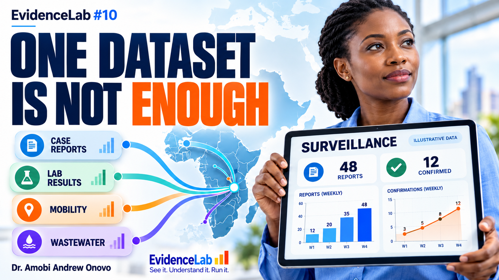
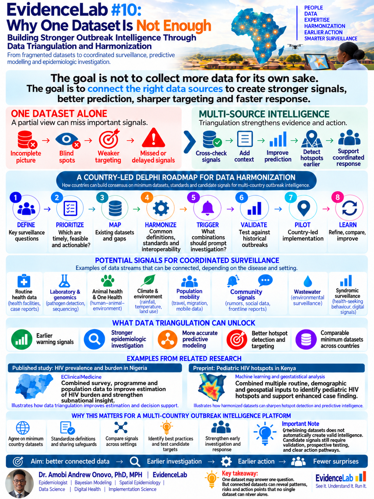

# EvidenceLab #10: Why One Dataset Is Not Enough

## Building stronger outbreak intelligence through data triangulation and harmonization

One dataset may answer one question. Connected datasets can reveal patterns, risks and opportunities for action that no single source can show alone.

[Watch the explainer on YouTube](https://youtu.be/ZILRjdjiwws) · [Download the final infographic](assets/data_triangulation_infographic.png) · [Download the thumbnail](assets/data_triangulation_thumbnail.png) · [YouTube-ready thumbnail JPEG](assets/data_triangulation_thumbnail_3840x2160.jpg)

### Compare evidence and make it comparable

**Data triangulation** means comparing evidence across sources to identify agreement, disagreement and gaps. Routine case reports, laboratory findings and environmental observations can contribute different information about the same public-health question. Agreement supports further assessment; it does not establish causality or validate a prediction.

**Data harmonization** means making definitions, measurement units, geographic boundaries and reporting periods sufficiently comparable for the intended analysis. It preserves source provenance, relevant measurement differences and uncertainty. It does not eliminate missing information or make incompatible measurements equivalent.

**HARMONIZE → TRIANGULATE → INVESTIGATE → ACT**

By the end of the lesson, viewers should be able to distinguish these complementary processes, explain how multiple data sources contribute to epidemiological research, and identify the evaluation and response steps required before a candidate signal supports action.

### Final infographic

### A country-led framework for testing candidate signals

Building on [Lesson 9's Delphi-informed approach](../09-anticipatory-epidemic-intelligence/README.md), this lesson proposes country-led consensus on minimum datasets, harmonization standards and candidate signals for future multi-country outbreak intelligence.

**DEFINE → PRIORITIZE → MAP → HARMONIZE → TRIGGER → VALIDATE → PILOT → LEARN**

Relevant inputs may include routine surveillance, laboratory and genomic data, animal health and One Health information, climate and environmental observations, population mobility, community signals, wastewater, census and demographic surveys, geospatial layers and syndromic surveillance. Select sources around the question, local priorities, data quality and feasibility.

The roadmap is a proposed framework. Candidate signals require historical validation, prospective evaluation, safeguards and defined public-health response pathways. Combining datasets guarantees neither improved predictive accuracy nor earlier outbreak detection.

### Two applications in HIV research

**Nigeria — peer-reviewed publication.** [*Estimation of HIV prevalence and burden in Nigeria: a Bayesian predictive modelling study*](https://pubmed.ncbi.nlm.nih.gov/37538543/) (eClinicalMedicine, 2023; [DOI](https://doi.org/10.1016/j.eclinm.2023.102098)) combines HIV testing programme data, survey information and population estimates in a Bayesian modelling workflow to estimate state-level prevalence and HIV burden.

**Kenya — preprint, not peer reviewed.** [*Pediatric HIV Hotspots in Kenya: Machine Learning and Geostatistical Analysis for Enhanced Case Finding*](https://www.medrxiv.org/content/10.64898/2026.04.24.26351710v2) combines pediatric testing records, demographic survey indicators, population denominators and county geography with Lasso regression and spatial analysis to investigate pediatric HIV hotspots.

These examples illustrate the methodological value of multi-source epidemiological research. They are not direct validation of outbreak early-warning prediction.

### Thumbnail and discussion

The thumbnail's dashboard is marked **illustrative data**. Its teaching values are not reported outbreak counts or research performance results. The published thumbnail is the owner-selected version with the EvidenceLab logo and signature.

**Which missing dataset would you prioritize to strengthen outbreak intelligence in your country?**

Created by **Dr. Amobi Andrew Onovo, PhD, MPH**
Epidemiology | Data Science | AI for Global Health

**EvidenceLab | See it. Understand it. Run it.**
