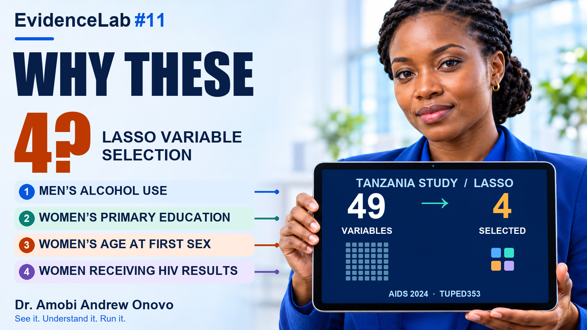
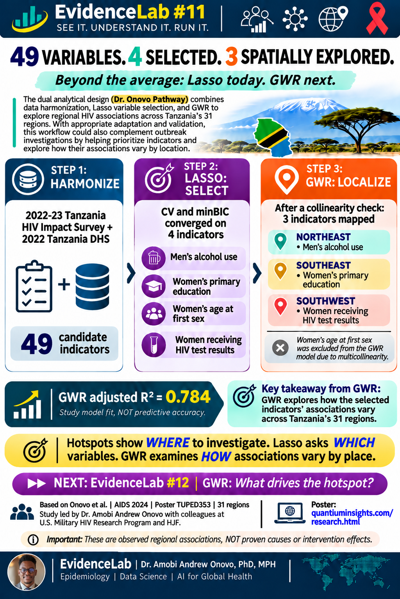

# Lesson 11: Why These Four?

Explore how Lasso narrows a set of variables and how geographically weighted regression examines regional associations. The Tanzania AIDS 2024 conference poster TUPED353 reported four Lasso selections from 49 variables and explored three indicators with GWR after screening for multicollinearity.

## Run it

[View or download the executed notebook](EvidenceLab_11_Lasso_Data_Cleaning_Interactive_Colab_v2_EXECUTED.ipynb). In Colab, choose **Runtime → Run all**. The exercises use synthetic data for data assessment, cleaning, and grouped Lasso validation.

## See it

[Research poster index](https://quantiuminsights.com/research.html) · See TUPED353 under Presentations, awards and funding.

The reported regional associations are observational. Adjusted R² is a model-fit statistic.

## Watch it

The YouTube link will be added when available.
