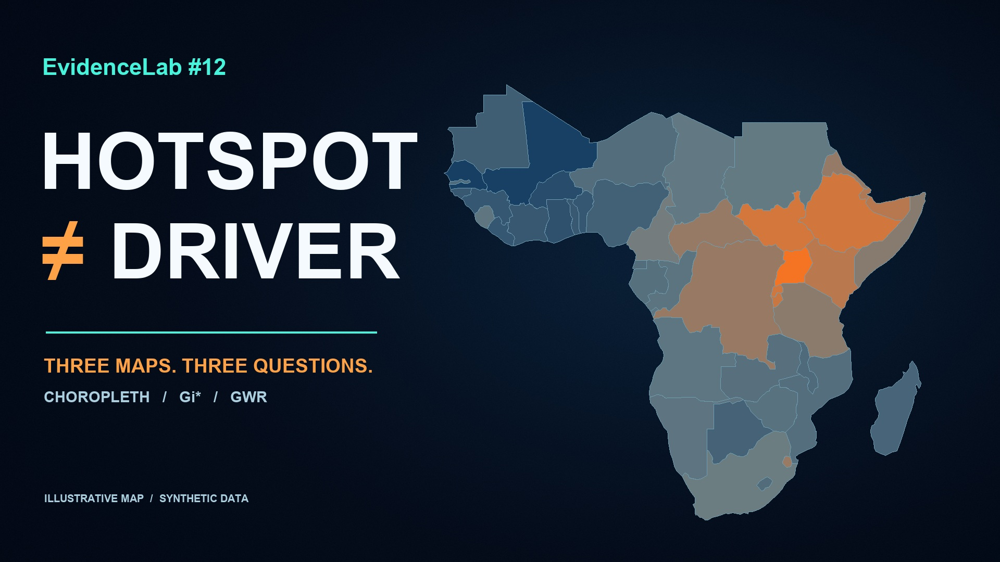
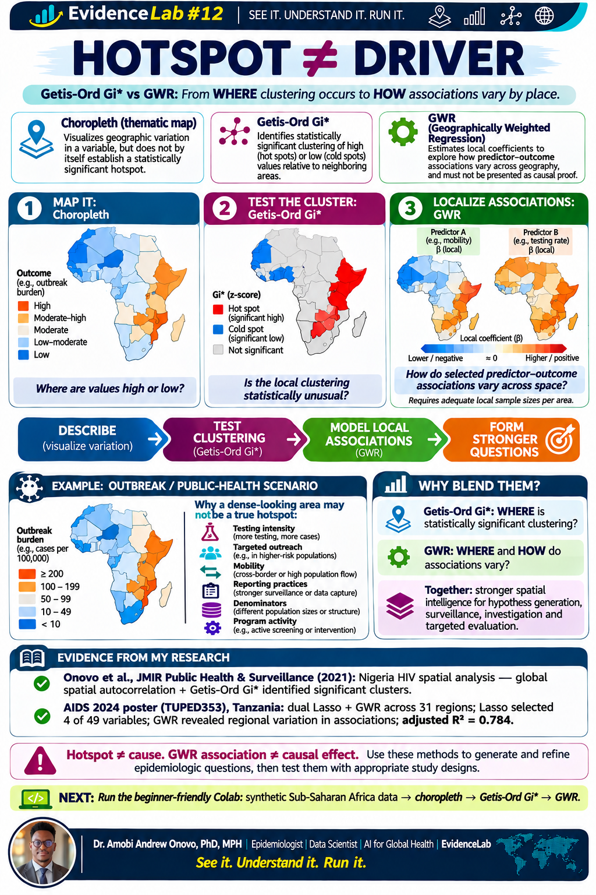

# EvidenceLab #12 · Hotspot ≠ Driver

Use a choropleth to describe spatial variation, Getis–Ord Gi* to test local clustering, and geographically weighted regression to estimate how associations vary by place.

## Run it

Choose **Runtime → Run all**. The notebook generates the teaching data and retrieves public Natural Earth boundaries. It requires no data upload or account key.

## See it

- [Nigeria HIV spatial analysis](https://publichealth.jmir.org/2021/5/e19587/)
- [Tanzania AIDS 2024 poster TUPED353](https://quantiuminsights.com/research.html)

## Watch it

The explainer link will be added when available.
