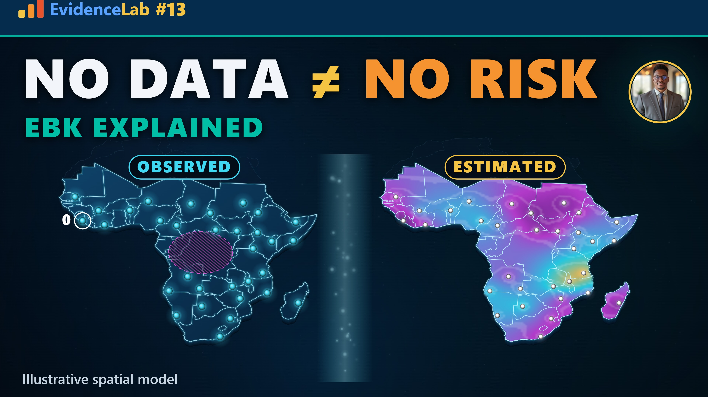
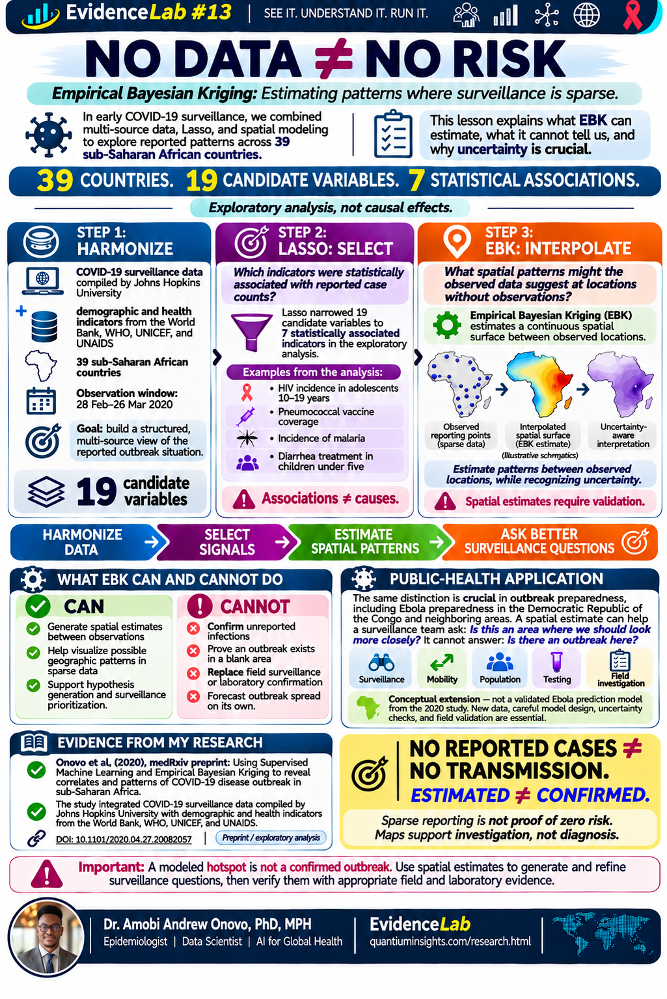

# EvidenceLab #13 · No Data ≠ No Risk

Empirical Bayesian kriging estimates spatial patterns between observations. This lesson explains how to interpret those estimates and their uncertainty in sparse surveillance.

## Watch the explainer

[Watch the explainer on YouTube](https://www.youtube.com/watch?v=vYiFLvz3ZhM) · [Download or play the native 4K video](https://github.com/amobionovo/EvidenceLab/releases/download/lesson-13-no-data-not-no-risk/EvidenceLab13_NoDataNotNoRisk_16x9_Native4K.mp4)

[Release and video download](https://github.com/amobionovo/EvidenceLab/releases/tag/lesson-13-no-data-not-no-risk) · [Captions](captions/EvidenceLab13_NoDataNotNoRisk_16x9.srt) · [Transcript](Transcript.md)

## See the infographic

## Research context

The lesson draws on Onovo et al. (2020), *Using Supervised Machine Learning and Empirical Bayesian Kriging to reveal Correlates and Patterns of COVID-19 Disease outbreak in sub-Saharan Africa: Exploratory Data Analysis*. This medRxiv preprint analyzed reported early COVID-19 patterns across 39 countries during 28 February–26 March 2020.

[Preprint](https://doi.org/10.1101/2020.04.27.20082057) · [Scientific evidence manifest](Scientific_Evidence_Manifest.md)

The film uses labeled illustrative teaching maps. Its preparedness application is a conceptual extension requiring current data and field validation.
