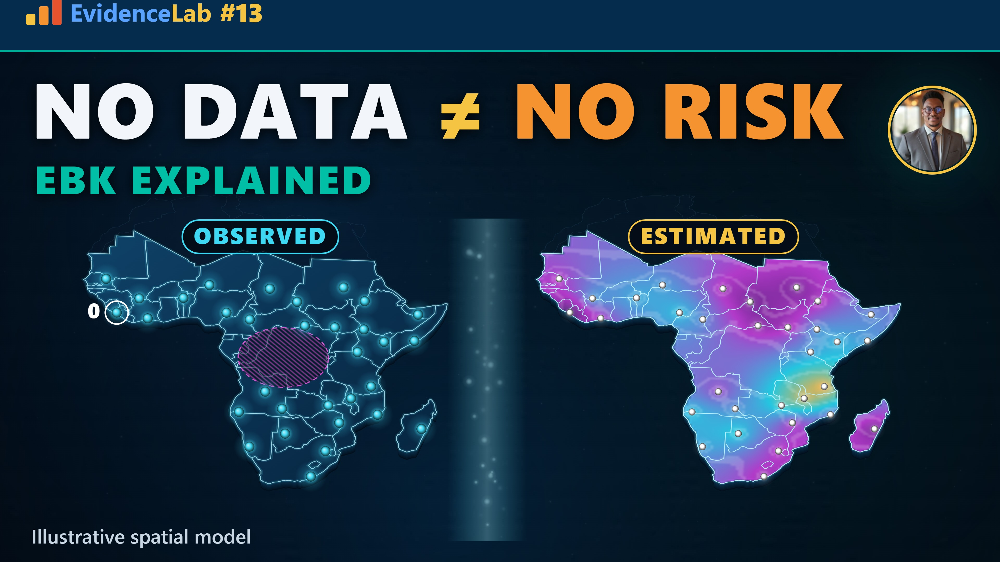
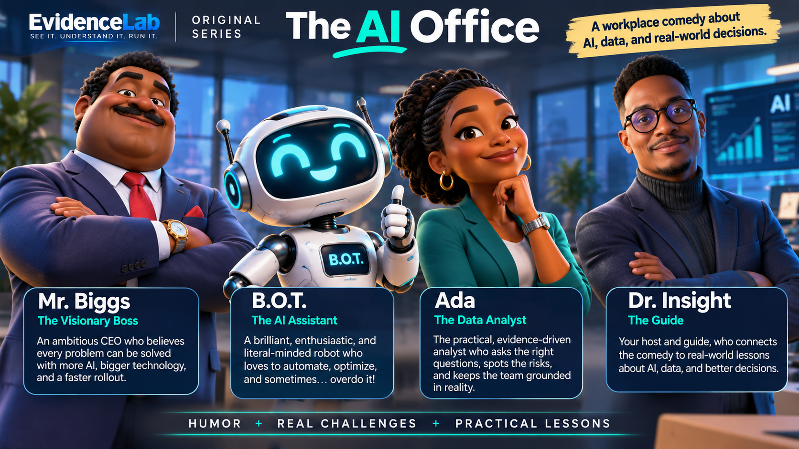

```{=html}
<style>
.el-home { --navy:#071b2b; --ink:#10283a; --blue:#004a7c; --mint:#62e2cb; --paper:#f7f7f2; background:var(--paper); color:var(--ink); font-family:system-ui,sans-serif; }
.el-home *, .el-home *::before, .el-home *::after { box-sizing:border-box; }
body:has(.el-home) #quarto-content { max-width:none; padding:0; margin:0; display:block; }
body:has(.el-home) #quarto-header .navbar { background:var(--navy,#071b2b)!important; }
.el-wrap { width:min(100% - 2.5rem, 74rem); margin-inline:auto; }
.el-hero { background: radial-gradient(ellipse at 87% 35%,#114759 0%,transparent 55%),var(--navy); color:white; padding-block:clamp(1rem,2.5vw,2rem); }
.el-story, .el-picks { display:grid; grid-template-columns:minmax(0,1fr) minmax(0,1fr); gap:clamp(1.75rem,5vw,4.5rem); align-items:center; }
.el-home h1,.el-home h2,.el-home h3 { margin:0 0 1rem; padding:0; border:0; line-height:1.05; letter-spacing:-.045em; color:inherit; }
.el-home h1 { font-size:clamp(2.8rem,6vw,5.25rem); font-weight:800; }
.el-home h1 span { display:block; color:var(--mint); }
.el-home h2 { font-size:clamp(2rem,4vw,3.7rem); font-weight:760; }
.el-home h3 { font-size:clamp(1.65rem,3vw,2.6rem); }
.el-home p { max-width:55ch; line-height:1.65; }
.el-home .el-kicker { text-transform:uppercase; font-size:.77rem; font-weight:750; letter-spacing:.15em; margin-bottom:.9rem; }
.el-hero .el-kicker { color:var(--mint); }
.el-lead { color:#dcecf1; font-size:1.12rem; }
.el-home a.el-button { display:inline-block; background:var(--mint); color:var(--navy); border-radius:.45rem; padding:.75rem 1rem; font-weight:750; text-decoration:none; }
.el-home a.el-link { color:var(--blue); font-weight:720; text-underline-offset:.2em; }
.el-home a.el-button:hover { background:white; }
.el-home :focus-visible { outline:3px solid #008378; outline-offset:5px; }
.el-hero :focus-visible { outline-color:var(--mint); }
.el-story { padding-block:clamp(1.5rem,4vw,3.25rem); }
.el-home img { display:block; width:100%; height:auto; border-radius:.65rem; }
.el-picks { align-items:stretch; gap:1.5rem; padding-bottom:clamp(2.5rem,6vw,5rem); }
.el-pick { padding:clamp(1.25rem,4vw,2.35rem); background:white; border:1px solid #d7e1df; border-radius:.9rem; }
.el-pick.el-office { background:var(--navy); color:white; border-color:var(--navy); }
.el-office img { margin-bottom:1.25rem; }
.el-office a.el-link { color:var(--mint); }
@media(max-width:48rem){ .el-story,.el-picks { grid-template-columns:minmax(0,1fr); } }

@scope (.el-hero) {
.lab{background:#0b2333;border:1px solid #426574;border-radius:20px;overflow:hidden;margin-top:16px}.steps{display:flex;gap:8px;flex-wrap:wrap;padding:8px 14px;border-bottom:1px solid #395466}.steps button{flex:1;min-width:95px}button{font:inherit;color:inherit;font-weight:650;background:#17384b;border:1px solid #537183;border-radius:8px;padding:6px 12px;cursor:pointer}button[aria-pressed=true],#simulate{background:var(--mint);color:#071b2b;border-color:var(--mint)}button:focus-visible,a:focus-visible,input:focus-visible{outline:3px solid #ffbc70;outline-offset:4px}.stage{padding:12px 14px;display:grid;grid-template-columns:minmax(0,2fr) minmax(250px,1fr);gap:12px;align-items:center}.stage svg{width:100%;height:auto;display:block}.card{background:#102c3c;border:1px solid #426574;border-radius:14px;padding:12px 14px;color:#f7fbff}.card #step-title{font-size:clamp(1.15rem,2vw,1.5rem);line-height:1.2;letter-spacing:-.025em;margin:0 0 .4rem;color:#f7fbff}.card #step-copy{font-size:.92rem;line-height:1.45;margin:0 0 .55rem}.controls label{color:#eaf7fa;font-size:.9rem}.card p{color:#b6ccd5}.controls{display:grid;gap:8px}.controls input{width:100%;accent-color:var(--mint)}.nav{display:flex;justify-content:space-between;gap:8px;align-items:center;margin-top:10px}.nav button:disabled{opacity:.5;cursor:default}a{color:var(--mint);text-underline-offset:3px}.foot{padding:0 14px 10px;color:#b6ccd5;font-size:.85rem}.flow{fill:none;stroke-linecap:round;transition:stroke-width .28s,opacity .28s}svg text{font-family:system-ui,sans-serif;fill:#eaf7fa}.tag{font-size:12px;letter-spacing:.09em;font-weight:750}.num{font-weight:800;font-size:26px}.small{font-size:13px;fill:#b6ccd5}@media(prefers-reduced-motion:reduce){.flow{transition:none}}

[hidden]{display:none!important}
.walkthrough-question{margin:0;padding:10px 14px 0;max-width:none;color:#dcecf1}
@media(max-width:740px){.stage{grid-template-columns:1fr;padding:12px}.card{padding:16px}}
}
 .el-hero details.el-walkthrough { margin-top: 1rem; }
.el-walkthrough summary { width: fit-content; max-width: 100%; padding: .65rem .9rem; border: 1px solid #547989; border-radius: .5rem; background: #102c3c; color: #f7fbff; font-weight: 700; cursor: pointer; }
.el-walkthrough summary::marker { color: var(--mint); }
.el-walkthrough summary:hover { border-color: var(--mint); }
</style>

<div class="el-home" role="main">
<section class="el-hero">
  <div class="el-wrap">
    <div>
      <p class="el-kicker">EvidenceLab</p>
      <h1>See It. Understand It. <span>Run It.</span></h1>
      <p class="el-lead">Explore statistics, data science, and public health through visual explainers and notebooks you can run yourself.</p>
      <a class="el-button" href="lessons.html">Explore the lessons</a>
    </div>
    <details class="el-walkthrough">
      <summary>Try the interactive walkthrough</summary>
    <section class="lab" aria-label="Interactive walkthrough">
<p class="walkthrough-question">Three clinics report different rates. What would you estimate for a community in between?</p><nav class="steps" aria-label="Walkthrough steps"><button data-step="0" aria-pressed="true">See it</button><button data-step="1" aria-pressed="false">Understand it</button><button data-step="2" aria-pressed="false">Run it</button></nav>
<div class="stage"><svg viewBox="0 0 620 324" role="img" aria-labelledby="diagram-title diagram-description">
<title id="diagram-title">Clinic reports flow into a weighted estimate</title><desc id="diagram-description">Three clinic rates feed a model. The estimated rate updates when the weighting rule changes.</desc>
<text class="tag" x="20" y="29">CLINIC REPORTS</text><text class="tag" x="259" y="29">WEIGHTING RULE</text><text class="tag" x="477" y="29">COMMUNITY</text>
<path id="flow0" class="flow" d="M 136 90 C 221 90 217 132 265 132" stroke="#65deca"/><path id="flow1" class="flow" d="M 136 166 C 215 166 218 166 265 166" stroke="#ffbc70"/><path id="flow2" class="flow" d="M 136 242 C 221 242 217 200 265 200" stroke="#a9a6fa"/>
<path id="outflow" class="flow" d="M 406 166 C 445 166 453 166 480 166" stroke="#65deca" stroke-width="16"/>
<g fill="#16394b" stroke="#416477"><rect x="20" y="61" width="116" height="58" rx="10"/><rect x="20" y="137" width="116" height="58" rx="10"/><rect x="20" y="213" width="116" height="58" rx="10"/><rect x="265" y="107" width="141" height="118" rx="13"/><rect x="480" y="115" width="122" height="102" rx="13"/></g>
<text x="34" y="85">Clinic A</text><text class="small" x="34" y="105">8 per 100</text><text x="34" y="161">Clinic B</text><text class="small" x="34" y="181">18 per 100</text><text x="34" y="237">Clinic C</text><text class="small" x="34" y="257">28 per 100</text>
<text class="small" x="287" y="140">Closest / farthest</text><text id="weights" x="287" y="172">—</text><text class="small" x="287" y="199">A / B / C</text>
<text id="estimate" class="num" x="502" y="163">—</text><text class="small" x="502" y="189">per 100</text><text class="small" x="20" y="308">Ribbon width shows how much each report contributes.</text></svg>
<div class="card"><h2 id="step-title">What did the clinics report?</h2><p id="step-copy">Clinic A is closest to the community and Clinic C is farthest. The community has no report of its own.</p>
<div id="controls" class="controls" hidden><label for="strength">Emphasis on nearby clinics <output id="strength-value" for="strength">50%</output></label><input id="strength" type="range" min="0" max="100" value="50" step="5"><button id="simulate" type="button">Run estimate</button><p id="result" role="status" hidden></p></div>
<div class="nav"><button id="prev" aria-label="Previous step" disabled>←</button><span id="progress">1 of 3</span><button id="next" aria-label="Next step">→</button></div></div></div>
<div class="foot">Synthetic example using a weighted average. <a href="https://www.youtube.com/watch?v=vYiFLvz3ZhM">Watch Lesson 13 on YouTube</a> to explore empirical Bayesian kriging.</div>
</section>
<script>(() => {
const steps=[
["What did the clinics report?","Clinic A is closest to the community and Clinic C is farthest. The community has no report of its own."],
["How do reports become an estimate?","The model combines the reports. When closer clinics get more weight, their ribbons get wider and their rates influence the estimate more."],
["What if proximity matters more?","Move the slider, then run the estimate. Compare the result with 18 per 100, the estimate when all three clinics count equally."]
];
const get=id=>document.getElementById(id);
const buttons=[...document.querySelectorAll("[data-step]")];
let step=0;
const rates=[8,18,28];
function draw(showEstimate){
 const emphasis=Number(get("strength").value)/100;
 const weights=[(1-emphasis)/3+emphasis*.65,(1-emphasis)/3+emphasis*.25,(1-emphasis)/3+emphasis*.10];
 weights.forEach((weight,i)=>{
  get("flow"+i).style.strokeWidth=showEstimate?2+weight*30:3;
  get("flow"+i).style.opacity=showEstimate?.82:.4;
 });
 get("outflow").style.opacity=showEstimate?.82:.18;
 const percentages=weights.map(weight=>Math.round(weight*100));
 percentages[1]+=100-percentages.reduce((sum,value)=>sum+value,0);
 get("weights").textContent=showEstimate?percentages.map(value=>value+"%").join(" / "):"—";
 const estimate=weights.reduce((sum,weight,i)=>sum+weight*rates[i],0).toFixed(1);
 get("estimate").textContent=showEstimate?estimate:"—";
 get("diagram-description").textContent=showEstimate?"The clinic rates combine to an estimate of "+estimate+" per 100.":"Three clinic reports show rates of 8, 18, and 28 per 100.";
 return estimate;
}
function showStep(index){
 step=index;
 buttons.forEach((button,i)=>button.setAttribute("aria-pressed",String(i===step)));
 get("step-title").textContent=steps[step][0];
 get("step-copy").textContent=steps[step][1];
 get("progress").textContent=(step+1)+" of 3";
 get("controls").hidden=step!==2;
 get("result").hidden=true;
 get("prev").disabled=step===0;
 get("next").disabled=step===2;
 draw(step!==0);
}
buttons.forEach((button,index)=>button.addEventListener("click",()=>showStep(index)));
get("prev").addEventListener("click",()=>showStep(step-1));
get("next").addEventListener("click",()=>showStep(step+1));
get("strength").addEventListener("input",()=>{get("strength-value").textContent=get("strength").value+"%";get("result").hidden=true;draw(false)});
get("simulate").addEventListener("click",()=>{const estimate=draw(true);get("result").hidden=false;get("result").textContent="Estimated rate: "+estimate+" per 100."});
showStep(0);
})();</script>
    </details>
  </div>
</section>

<section class="el-wrap el-story" aria-labelledby="el-story-title">
  <div>
    <p class="el-kicker">Featured lesson · 13</p>
    <h2 id="el-story-title">No Data ≠ No Risk</h2>
    <p>How do we interpret risk when surveillance data are sparse? Explore what empirical Bayesian kriging can estimate between observations and why the uncertainty matters.</p>
    <p><a class="el-link" href="https://github.com/amobionovo/EvidenceLab/blob/main/lessons/13-no-data-not-no-risk/README.md">Read Lesson 13</a> · <a class="el-link" href="https://www.youtube.com/watch?v=vYiFLvz3ZhM">Watch the explainer on YouTube</a></p>
  </div>
  
</section>

<div class="el-wrap el-picks">
  <article class="el-pick">
    <h3>Beyond the AI Hype</h3>
    <p class="el-kicker">Automation ≠ Transformation</p>
    <p>What changes when AI speeds up a broken process? Start with the first essay in the series.</p>
    <a class="el-link" href="beyond-ai-hype/index.html">Read the series</a>
  </article>
  <article class="el-pick el-office">
    
    <h3>The AI Office</h3>
    <p>A workplace comedy about AI, data, and real-world decisions.</p>
    <a class="el-link" href="originals/the-ai-office/index.html">Meet the cast</a>
  </article>
</div>
</div>
```


