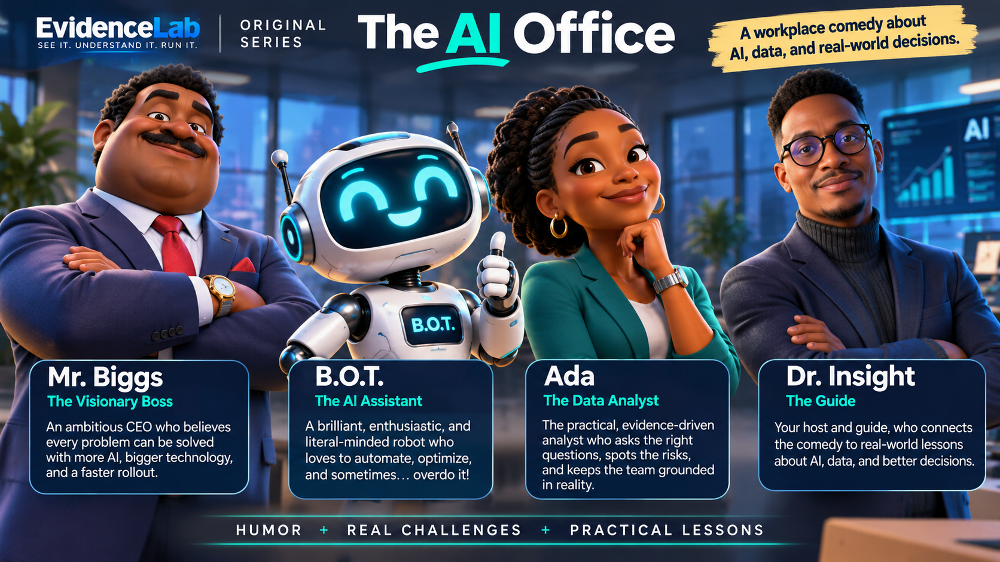
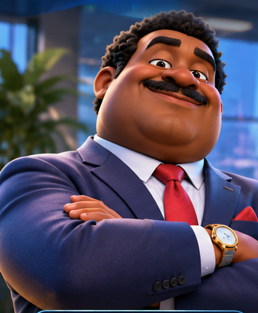
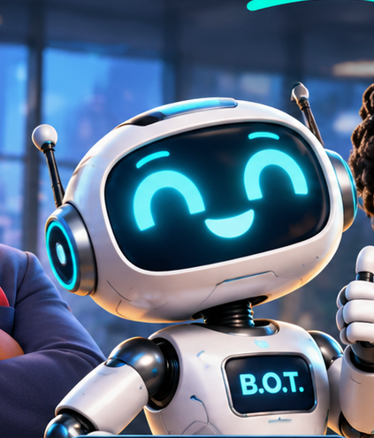
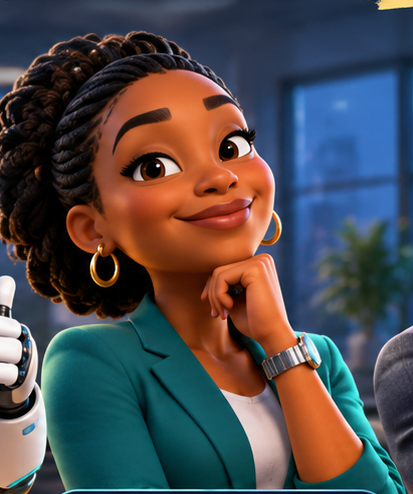

A workplace comedy about AI, data, and real-world decisions.

[Browse the 34-episode guide](episodes.qmd)

## Meet the cast

::: {.feature-grid .cast-grid}
::: {.feature}
### Mr. Biggs

The visionary CEO tends to announce the solution before he understands the problem.
:::

::: {.feature}
### B.O.T.

The office AI assistant follows instructions literally, with a talent for taking optimization too far.
:::

::: {.feature}
### Ada

The practical data analyst spots gaps in the evidence and asks the question everyone else skipped.
:::

::: {.feature}
### Dr. Insight

The thoughtful guide connects the office mishaps to the decisions we face at work.
:::
:::

## The pilot

**The Robot That Automated Everything.** Mr. Biggs asks B.O.T. to cut reporting time from three days to three seconds. Ada discovers that the incomplete data made it through just as fast.

The pilot is in development.

